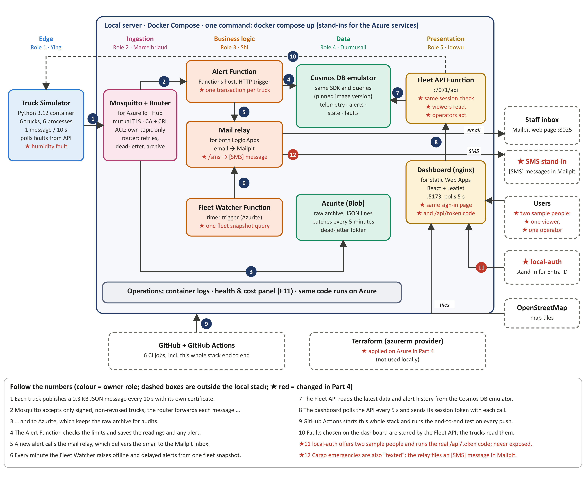

# GreenOps Cloud Pulse – Smart Fleet & Cold-Chain Telemetry Tracker

CST8922 – Capstone Project · Group 3 · Category 4: IoT & Real-Time Processing

Six simulated refrigerated trucks send GPS, temperature, humidity and door readings every 10 seconds. The system checks every
reading against the cargo's safe range, emails staff within 30 seconds when something goes wrong, keeps a raw archive for audits
and shows the fleet on a live map.

This repository is the **Part 3 code submission**. The whole system runs **on one computer** with Docker, where each Azure service
from the Part 2 design has a local stand-in, and the **same code is deployed live on Microsoft Azure**:
<https://purple-tree-07c86780f.2.azurestaticapps.net>. Commit history: <https://github.com/Canadasun/greenops-cloud-pulse/commits/main>.

**Quick start:** read *Folder structure* to find each part, then *Run it on your computer*.



## Who owns what

| Role | Owner | Folder | Requirements |
|---|---|---|---|
| 1 – Edge & Telemetry Simulation | Ying Song | `simulator/`, `contracts/` | FR-01, FR-02 |
| 2 – Cloud Ingestion & Message Broker | Marcelbriaud Wafotchoupe | `broker/`, `scripts/`, `infra/` | FR-03, FR-04 |
| 3 – Event Processing & Alerting | Shi Wang | `functions/shared/alert*.py`, `fleet_watcher.py`, `mail-relay/` | FR-05 – FR-08 |
| 4 – Cloud Storage & Cost Analysis | Durmusali Unal | `functions/shared/repository.py`, archive in `broker/router` | FR-09, F11 cost model |
| 5 – Dashboard & User Deliverables | Idowu Ayeni | `dashboard/`, `functions/shared/dashboard_api.py` | FR-10, FR-11 |

Email (Role 3): every alert is saved first with `email_status = pending`. On Azure the Logic App claims the alert, sends the email through Azure Communication Services and reports the result; locally the mail relay delivers to Mailpit. Failed sends are retried with growing waits up to a fixed limit, then marked `abandoned` (the alert stays open on the dashboard). The Fleet Watcher skips trucks whose last reading is `parked`.

## Azure design → local stand-in

| Part 2 (Azure) | Local (this build) | Port |
|---|---|---|
| Truck simulator | `simulator` – Python 3.12, one process per truck, fault API | 8090 |
| Azure IoT Hub (X.509 per device, own topic) | `mosquitto` – MQTT with mutual TLS, CA + CRL, topic ACL | 8883 |
| IoT Hub message routing | `router` – to the Alert Function (batches, retries, dead-letter) and the archive | – |
| Azure Functions (alerts, fleet watcher, Fleet API) | `functions` – the official Azure Functions Python image | 7071 |
| Azure Logic App (email) | `mail-relay` → `mailpit` inbox | 8025 |
| Azure Cosmos DB | `cosmos` – Cosmos DB emulator (Data Explorer on 1234) | 8081 |
| Azure Blob Storage | `azurite` | 10000 |
| Azure Static Web Apps | `dashboard` – nginx serving the React build | **5173** |

## Folder structure

```
greenops-cloud-pulse/
├── simulator/          Role 1 – truck simulator: six trucks, routes, cargo profiles, fault scenarios (Python)
├── contracts/          Role 1 – shared data contract: message JSON Schema, fleet and cargo limits
├── broker/             Role 2 – Mosquitto broker with mutual TLS, access rules, revocation list
│   └── router/         Role 2 – message routing to the Alert Function and the Blob archive (stand-in for IoT Hub routing)
├── functions/          Roles 3, 4, 5 – Azure Functions app (Python)
│   ├── function_app.py     all triggers: Alert Function, Fleet Watcher timer, Fleet API routes
│   └── shared/             alert rules, fleet watcher, validation, storage repository, Fleet API, sign-in
├── mail-relay/         Role 3 – local stand-in for the Logic App that sends alert emails
├── dashboard/          Role 5 – React + Leaflet web dashboard (TypeScript, Vite)
├── e2e/                end-to-end tests of the whole system, browser tests and the live Azure checks
├── infra/terraform/    Terraform that creates every Azure resource
├── scripts/            certificates, local set-up, Azure device registration and deployment
├── docs/               architecture diagrams and review notes
├── docker-compose.yml  starts the whole local system (10 services)
└── .github/workflows/  CI: GitHub Actions runs every test on each pull request
```

Each module starts with a comment naming its owner and the requirement it implements. More detail is in the
README inside `simulator/`, `broker/`, `functions/` and `dashboard/`.

## Run it on your computer

**You need:** Docker Desktop (or Docker Engine with Compose), Git, Python 3 and OpenSSL. No Azure account is needed.

```bash
git clone https://github.com/Canadasun/greenops-cloud-pulse.git && cd greenops-cloud-pulse
python3 scripts/init_local.py       # 1. create local operator and service keys in .env (not committed)
bash scripts/make_certs.sh          # 2. create the device certificates (not committed)
docker compose up -d --build        # 3. build and start all 10 services (first time: a few minutes)
# 4. open http://localhost:5173 (dashboard) and http://localhost:8025 (alert inbox)
docker compose down                 # 5. stop everything
```

To try an alert: in the dashboard choose **Read-only · Connect operator**, paste an operator key from `.env`, open
**System → Demo fault scenarios** and set TRK-003 to **Compressor failure**. About a minute later the alert appears on the dashboard
and its email arrives in the inbox at http://localhost:8025.

## Run it on Azure

The same code runs on the Azure services from the Part 2 design. The six trucks run as an Azure Container Apps job
that any team member with Contributor on the resource group starts with **Run now**; each run stops itself after
90 minutes (`truck_run_minutes`), which keeps two runs a day inside the IoT Hub F1 free quota of 8,000 messages.

```bash
# 0. Once per subscription: the remote, versioned, locked home of the Terraform state (Role 2)
bash scripts/bootstrap_tfstate.sh
# 1. Infrastructure (Terraform, azurerm) – settings go in infra/terraform/azure.auto.tfvars (not committed),
#    including operator_emails = { "<Microsoft account email>" = "<operator name>" } and a random
#    delivery_callback_token (32+ chars); everyone else who signs in can only view.
#    State lives in Azure (storage account stgreenopsg3tfstate); you need Storage Blob Data Contributor on it.
cd infra/terraform && terraform init && terraform plan -out=tfplan   # review the plan, then:
terraform apply tfplan && cd ../..
# 2. Register each truck's certificate in IoT Hub (Role 2)
bash scripts/register_azure_devices.sh "$(terraform -chdir=infra/terraform output -raw iot_hub_name)"
# 3. Publish the Functions and the dashboard
bash scripts/deploy_azure_app.sh
# 4. Copy the simulator code, reference data and truck certificates to the job's Azure Files share
bash scripts/upload_truck_files.sh
# 5. Start a 90-minute truck run (or portal: Container Apps job → Run now; stop early with az containerapp job stop)
az containerapp job start -g "$(terraform -chdir=infra/terraform output -raw resource_group)" \
  -n "$(terraform -chdir=infra/terraform output -raw truck_job)"
# Fallback: run the trucks on a PC instead – bash scripts/start_azure_trucks.sh
```

Check every feature on the live deployment (set the demo faults first – see the comments at the top of each script):

```bash
GREENOPS_URL=https://<static web app> GREENOPS_API=https://<function app>/api GREENOPS_OPERATOR_KEY=<key> \
  node e2e/azure_live_check.cjs                    # F1–F12 in Chromium, the way a dispatcher uses it
python e2e/azure_live_backend.py <resource-group> <iot-hub> <storage-account>   # F5 certificates, F6 archive
```

| Local stand-in | Azure (deployed) |
|---|---|
| Mosquitto + router | IoT Hub F1, free (X.509 thumbprint per truck) + message routes to the Alert Function and Blob archive |
| Functions container (HTTP trigger) | Function app, Flex Consumption, IoT Hub trigger, managed identity for Cosmos DB |
| mail-relay + Mailpit | Logic App → Azure Communication Services email |
| Cosmos DB emulator | Cosmos DB for NoSQL (free tier, or serverless when the free-tier slot is taken) |
| Azurite | Storage account, `telemetry-archive` container, 30-day move to the Archive tier |
| nginx | Static Web Apps (Free) – calls the Function app directly (CORS) |
| simulator fault API | `/api/sim/trucks` on the Function app; the trucks poll it (`FAULTS_URL`) |
| simulator container | Container Apps job (Consumption profile, manual trigger, 0.25 vCPU) running from an Azure Files share |

## Tests

| Suite | Command | Tests |
|---|---|---|
| Simulator | `cd simulator && python -m pytest` | 27 |
| Broker security (live broker) | `python -m pytest broker/tests` | 5 |
| Router | `cd broker/router && python -m pytest` | 11 |
| Functions + storage contract | `cd functions && python -m pytest` (`COSMOS_ENDPOINT=http://localhost:8081` adds Cosmos integration cases) | 65 / 89 |
| Mail relay | `cd mail-relay && python -m pytest` | 7 |
| Dashboard | `cd dashboard && npm run typecheck && npm test` | 26 + API types |
| Browser + accessibility regressions (Chromium) | `cd dashboard && npm run build && npm run test:browser` | 45 axe scans; responsive views, keyboard/focus, operator actions, outages, leaving the map mid-zoom |
| **End to end** (whole system) | `docker compose -f docker-compose.yml -f e2e/compose.e2e.yml up -d --build && python -m pytest e2e` | 9 |
| **Total in CI** | | **174** |

GitHub Actions (`.github/workflows/ci.yml`) runs every suite on each pull request and on each push to `main`. The Cosmos DB emulator image is pinned by digest in `docker-compose.yml` so a new preview release cannot break the storage tests.

## Message format

`contracts/telemetry.schema.json` (Part 1, Appendix A) – about 0.3 KB per message.

## Team code reviews

The team reviewed the code base twice and fixed every finding with a test:

- **7 October 2026** – whole-system review: [findings](docs/audit-2026-10-07/REPORT.md) and [fixes](docs/audit-2026-10-07/FIXES.md) (authentication, persistence, retries, test instructions), plus the [dashboard UI/UX review](docs/audit-2026-10-07/UI-UX-RECOMMENDATIONS.md).
- **10 October 2026** – dashboard review: [proposal](docs/audit-2026-10-10/FRONTEND-AUDIT.md) and [implementation notes](docs/audit-2026-10-10/IMPLEMENTATION.md) (new views, accessibility checks).
