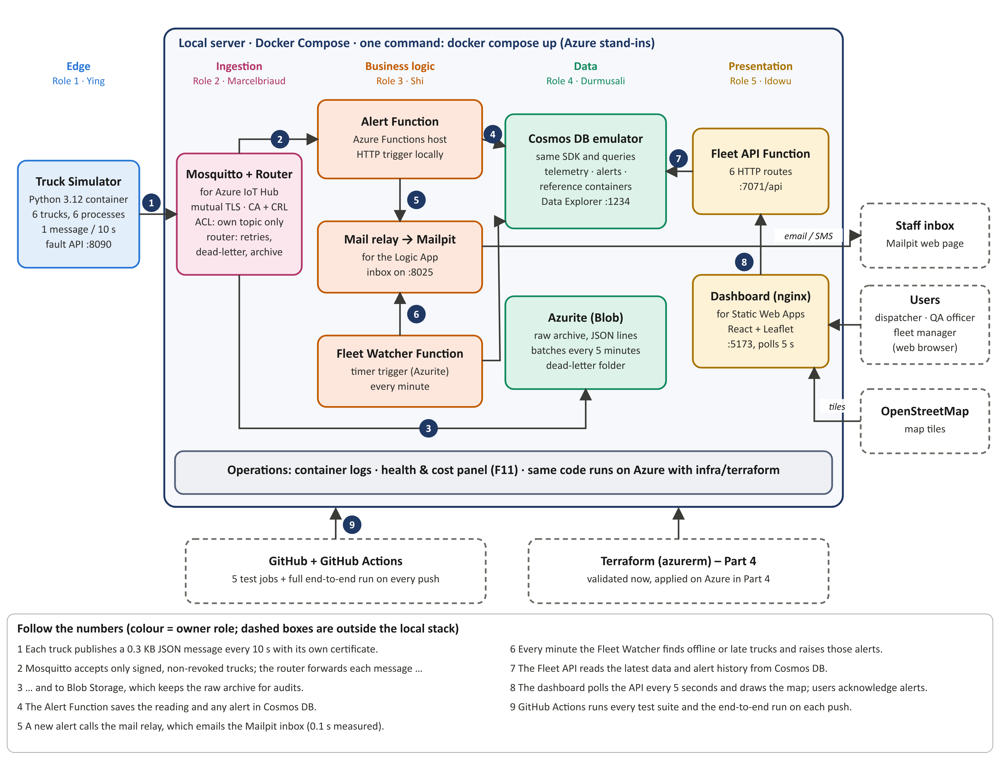

# GreenOps Cloud Pulse – Smart Fleet & Cold-Chain Telemetry Tracker

CST8922 Cloud DevOps · Group 3 · Category 4: IoT & Real-Time Processing

Six simulated refrigerated trucks send GPS, temperature, humidity and door readings every 10 seconds. The system checks every
reading against the cargo's safe range, emails staff within 30 seconds when something goes wrong, keeps a raw archive for audits
and shows the fleet on a live map. This repository is the **Part 3 build**: the complete pipeline runs **on a local server** with
Docker stand-ins for each Azure service in the Part 2 design, and the same code is ready for Azure (`infra/terraform`).



## Who owns what

| Role | Owner | Folder | Requirements |
|---|---|---|---|
| 1 – Edge & Telemetry Simulation | Ying Song | `simulator/`, `contracts/` | FR-01, FR-02 |
| 2 – Cloud Ingestion & Message Broker | Marcelbriaud Wafotchoupe | `broker/`, `scripts/`, `infra/` | FR-03, FR-04 |
| 3 – Event Processing & Alerting | Shi Wang | `functions/shared/alert*.py`, `fleet_watcher.py`, `mail-relay/` | FR-05 – FR-08 |
| 4 – Cloud Storage & Cost Analysis | Durmusali Unal | `functions/shared/repository.py`, archive in `broker/router` | FR-09, F11 cost model |
| 5 – Dashboard & User Deliverables | Idowu Ayeni | `dashboard/`, `functions/shared/dashboard_api.py` | FR-10, FR-11 |

## Azure design → local stand-in

| Part 2 (Azure) | Local (this build) | Port |
|---|---|---|
| Truck simulator | `simulator` – Python 3.12, one process per truck, fault API | 8090 |
| Azure IoT Hub (X.509 per device, own topic) | `mosquitto` – MQTT with mutual TLS, CA + CRL, topic ACL | 8883 |
| IoT Hub message routing | `router` – to the Alert Function (batches, retries, dead-letter) and the archive | – |
| Azure Functions (alerts, fleet watcher, Fleet API) | `functions` – the official Azure Functions Python image | 7071 |
| Azure Logic App (email) | `mail-relay` → `mailpit` inbox | 8025 |
| Azure Cosmos DB | `cosmos` – Cosmos DB emulator (Data Explorer on 1234) | 8081 |
| Azure Blob Storage | `azurite` | 10000 |
| Azure Static Web Apps | `dashboard` – nginx serving the React build | **5173** |

## Run it

```bash
bash scripts/make_certs.sh          # 1. create the device certificates (never committed)
docker compose up -d --build        # 2. start all 10 services
# 3. open http://localhost:5173 (dashboard) and http://localhost:8025 (alert inbox)
docker compose down                 # stop
```

Try a fault from the dashboard's **Demo: fault scenarios** panel, or:
`curl -X POST localhost:8090/trucks/TRK-003/fault -H 'Content-Type: application/json' -d '{"scenario":"compressor"}'`

## Tests

| Suite | Command | Tests |
|---|---|---|
| Simulator | `cd simulator && python -m pytest` | 18 |
| Broker security (live broker) | `python -m pytest broker/tests` | 5 |
| Router | `cd broker/router && python -m pytest` | 8 |
| Functions + storage contract | `cd functions && python -m pytest` (`COSMOS_ENDPOINT=http://localhost:8081` adds 7 Cosmos tests) | 32 / 39 |
| Mail relay | `cd mail-relay && python -m pytest` | 3 |
| Dashboard | `cd dashboard && npm test` | 9 |
| **End to end** (whole system) | `docker compose -f docker-compose.yml -f e2e/compose.e2e.yml up -d --build && python -m pytest e2e` | 9 |

GitHub Actions (`.github/workflows/ci.yml`) runs every suite on each push and pull request.

## Message format

`contracts/telemetry.schema.json` (Part 1, Appendix A) – about 0.3 KB per message.
