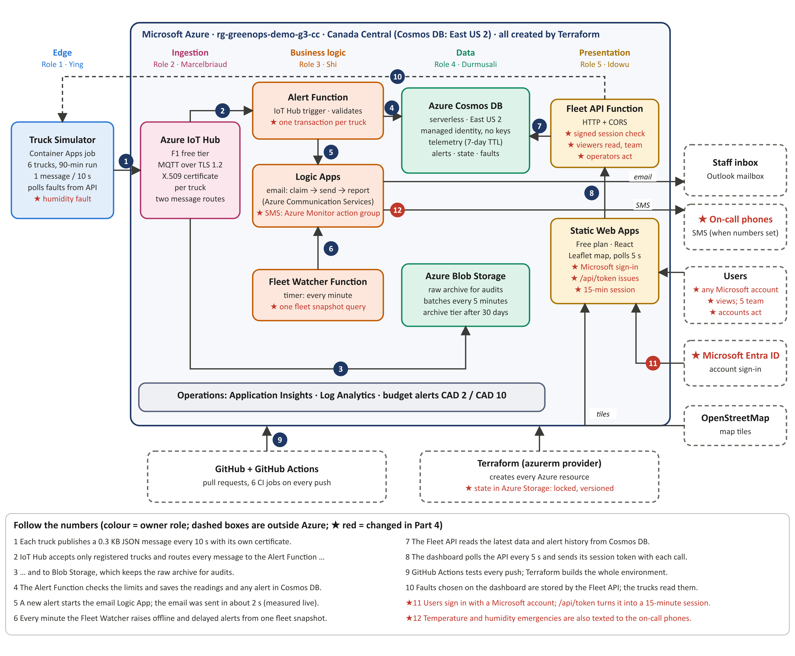

# GreenOps Cloud Pulse – Smart Fleet & Cold-Chain Telemetry Tracker

CST8922 – Capstone Project · Group 3 · Category 4: IoT & Real-Time Processing

Six simulated refrigerated trucks send GPS, temperature, humidity and door readings every 10 seconds. The system checks every
reading against the cargo's safe range, emails staff within 30 seconds when something goes wrong, keeps a raw archive for audits
and shows the fleet on a live map.

This repository is the **Part 4 (final) code submission**. The **same code runs live on Microsoft Azure**
(<https://purple-tree-07c86780f.2.azurestaticapps.net>, Microsoft sign-in) and **on one computer** with Docker, where each Azure
service has a local stand-in. Commit history: <https://github.com/Canadasun/greenops-cloud-pulse/commits/main>
(Part 4 work: <https://github.com/Canadasun/greenops-cloud-pulse/commits/part4-launch>).

**Quick start:** read *What Part 4 added*, then *Folder structure* to find each part, then *Run it on your computer*.



## What Part 4 added

| Promise (Part 1) | Owner | What was built | Proof |
|---|---|---|---|
| F12 sign-in | Idowu Ayeni | Microsoft sign-in on Static Web Apps; `/api/token` (`swa-api/`) turns it into a 15-minute signed session. Any account may **view**; only the accounts in `OPERATOR_EMAILS` (the five team members) may **act**. The old operator keys are gone. | live check: viewer gets 403, operator acknowledges |
| F13 SMS | Shi Wang | `SmsNotifier` + SMS outbox fields; on Azure a small Logic App run triggers an Azure Monitor action group that texts the on-call phones (numbers live only in Azure, never in git). Off until `sms_phones` is set. | `functions/tests/test_sms.py`; live check |
| F2 humidity on demand | Ying Song, Shi Wang | new `humidity` fault scenario in the simulator and the fault panel | live: humidity email in 1.7 s |
| NFR-04 100 trucks | Ying Song, Marcelbriaud Wafotchoupe, Durmusali Unal | `load/`: 100-truck fleet, load test and benchmark | local: 3,000 / 3,000 readings, p95 2.2 s |
| Optimisation | Shi Wang, Durmusali Unal, Idowu Ayeni | one fleet-snapshot query per minute, one transaction per truck, batched writes | 100-truck ingest 13.4 s → 2.4 s (`load/benchmark.py`) |
| Remote Terraform state (Part 1, Table 6) | Marcelbriaud Wafotchoupe | `scripts/bootstrap_tfstate.sh`; state in Azure Storage, locked and versioned | identical plan before and after the move |
| No duplicate emails | Shi Wang | `scripts/check_email_duplicates.py` compares Logic App runs with stored alerts | 24 alerts = 24 emails since the Oct 11 fix |

Diagrams (sources in `docs/diagrams/`, `npm install && npm run render` redraws them; ★ marks a Part 4 change):
[Azure architecture](docs/architecture-azure.png) · [local architecture](docs/architecture-local.png) ·
[UML class diagram](docs/class-diagram.png) · [use cases](docs/use-case.png) ·
[sign-in sequence](docs/sequence-signin.png) · [alert email + SMS sequence](docs/sequence-alert-notify.png)

## Who owns what

| Role | Owner | Folder | Requirements |
|---|---|---|---|
| 1 – Edge & Telemetry Simulation | Ying Song | `simulator/`, `contracts/` | FR-01, FR-02 |
| 2 – Cloud Ingestion & Message Broker | Marcelbriaud Wafotchoupe | `broker/`, `scripts/`, `infra/` | FR-03, FR-04 |
| 3 – Event Processing & Alerting | Shi Wang | `functions/shared/alert*.py`, `fleet_watcher.py`, `mail-relay/` | FR-05 – FR-08 |
| 4 – Cloud Storage & Cost Analysis | Durmusali Unal | `functions/shared/repository.py`, archive in `broker/router` | FR-09, F11 cost model |
| 5 – Dashboard & User Deliverables | Idowu Ayeni | `dashboard/`, `swa-api/`, `local-auth/`, `functions/shared/dashboard_api.py`, `auth.py`, `session.py` | FR-10, FR-11, F12 |
| Scale test (Part 4) | Ying Song, Marcelbriaud Wafotchoupe, Durmusali Unal | `load/` | NFR-04 |

Email (Role 3): every alert is saved first with `email_status = pending`. On Azure the Logic App claims the alert, sends the email through Azure Communication Services and reports the result; locally the mail relay delivers to Mailpit. Failed sends are retried with growing waits (30 s → 1 h) up to 8 attempts, then marked `abandoned` (the alert stays open on the dashboard). The Fleet Watcher skips trucks whose last reading is `parked`.

SMS (Role 3, Part 4): temperature and humidity emergencies are also texted, at most 160 plain characters, through the same claim-and-retry pattern (`sms_status`). Locally the mail relay files each text as an `[SMS]` message in Mailpit.

Sign-in (Role 5, Part 4): the dashboard shows nothing until the person signs in. Every Fleet API call carries the 15-minute session; `auth.py` lets any signed-in account read and only `OPERATOR_EMAILS` acknowledge alerts or set demo faults. Locally `local-auth` offers two sample people instead of Microsoft accounts and must never be exposed to a network.

## Azure design → local stand-in

| Part 2 (Azure) | Local (this build) | Port |
|---|---|---|
| Truck simulator | `simulator` – Python 3.12, one process per truck, fault API | 8090 |
| Azure IoT Hub (X.509 per device, own topic) | `mosquitto` – MQTT with mutual TLS, CA + CRL, topic ACL | 8883 |
| IoT Hub message routing | `router` – to the Alert Function (batches, retries, dead-letter) and the archive | – |
| Azure Functions (alerts, fleet watcher, Fleet API) | `functions` – the official Azure Functions Python image | 7071 |
| Azure Logic App (email) and Azure Monitor (SMS) | `mail-relay` → `mailpit` inbox (texts marked `[SMS]`) | 8025 |
| Azure Cosmos DB | `cosmos` – Cosmos DB emulator (Data Explorer on 1234) | 8081 |
| Azure Blob Storage | `azurite` | 10000 |
| Azure Static Web Apps | `dashboard` – nginx serving the React build | **5173** |
| Static Web Apps sign-in + `/api/token` | `local-auth` – two sample people, runs the real `swa-api` token code | (behind 5173) |

## Folder structure

```
greenops-cloud-pulse/
├── simulator/          Role 1 – truck simulator: six trucks, routes, cargo profiles, fault scenarios (Python)
├── contracts/          Role 1 – shared data contract: message JSON Schema, fleet and cargo limits
├── broker/             Role 2 – Mosquitto broker with mutual TLS, access rules, revocation list
│   └── router/         Role 2 – message routing to the Alert Function and the Blob archive (stand-in for IoT Hub routing)
├── functions/          Roles 3, 4, 5 – Azure Functions app (Python)
│   ├── function_app.py     all triggers: Alert Function, Fleet Watcher timer, Fleet API routes
│   └── shared/             alert rules, fleet watcher, validation, storage repository, Fleet API, sign-in
├── mail-relay/         Role 3 – local stand-in for the email Logic App and Azure Monitor SMS
├── dashboard/          Role 5 – React + Leaflet web dashboard (TypeScript, Vite), sign-in page
├── swa-api/            Role 5 – /api/token on Static Web Apps: Microsoft sign-in → 15-minute session (Node)
├── local-auth/         Role 5 – local stand-in for Static Web Apps sign-in (two sample people; never expose it)
├── load/               Roles 1, 2, 4 – 100-truck fleet, load test and hot-path benchmark (NFR-04)
├── e2e/                end-to-end tests of the whole system, browser tests and the live Azure checks
├── infra/terraform/    Terraform that creates every Azure resource (state kept in Azure Storage)
├── scripts/            certificates, local set-up, remote-state bootstrap, deployment, duplicate-email check
├── docs/               architecture, UML and sequence diagrams (sources in docs/diagrams) and review notes
├── docker-compose.yml  starts the whole local system (10 services)
└── .github/workflows/  CI: GitHub Actions runs every test on each pull request
```

Each module starts with a comment naming its owner and the requirement it implements. More detail is in the
README inside `simulator/`, `broker/`, `functions/`, `dashboard/`, `mail-relay/`, `swa-api/` and `load/`.

## Run it on your computer

**You need:** Docker Desktop (or Docker Engine with Compose), Git, Python 3 and OpenSSL. No Azure account is needed.

```bash
git clone https://github.com/Canadasun/greenops-cloud-pulse.git && cd greenops-cloud-pulse
python3 scripts/init_local.py       # 1. create the local service keys and session signing key in .env (not committed)
bash scripts/make_certs.sh          # 2. create the device certificates (not committed)
docker compose up -d --build        # 3. build and start all 10 services (first time: a few minutes)
# 4. open http://localhost:5173 (dashboard) and http://localhost:8025 (alert inbox)
docker compose down                 # 5. stop everything
```

To try an alert: open the dashboard, choose **Sign in** and pick **Local dispatcher (may act)** (the other sample person may only
view). Open **System → Demo fault scenarios** and set TRK-003 to **Compressor failure** or TRK-001 to **Humidity**. About a minute
later the alert appears on the dashboard and its email arrives in the inbox at http://localhost:8025.

## Run it on Azure

The same code runs on the Azure services from the Part 2 design. The six trucks run as an Azure Container Apps job
that any team member with Contributor on the resource group starts with **Run now**; each run stops itself after
90 minutes (`truck_run_minutes`), which keeps two runs a day inside the IoT Hub F1 free quota of 8,000 messages.

```bash
# 0. Once per subscription: the remote, versioned, locked home of the Terraform state (Role 2)
bash scripts/bootstrap_tfstate.sh
# 1. Infrastructure (Terraform, azurerm) – settings go in infra/terraform/azure.auto.tfvars (not committed),
#    including operator_emails = { "<Microsoft account email>" = "<operator name>" } and a random
#    delivery_callback_token (32+ chars); everyone else who signs in can only view. For SMS add
#    sms_phones = { "<label>" = "<10-digit mobile number>" } (the numbers stay in Azure; leave it out to keep SMS off).
#    State lives in Azure (storage account stgreenopsg3tfstate); you need Storage Blob Data Contributor on it.
cd infra/terraform && terraform init && terraform plan -out=tfplan   # review the plan, then:
terraform apply tfplan && cd ../..
# 2. Register each truck's certificate in IoT Hub (Role 2)
bash scripts/register_azure_devices.sh "$(terraform -chdir=infra/terraform output -raw iot_hub_name)"
# 3. Publish the Functions and the dashboard
bash scripts/deploy_azure_app.sh
# 4. Copy the simulator code, reference data and truck certificates to the job's Azure Files share
bash scripts/upload_truck_files.sh
# 5. Start a 90-minute truck run (or portal: Container Apps job → Run now; stop early with az containerapp job stop)
az containerapp job start -g "$(terraform -chdir=infra/terraform output -raw resource_group)" \
  -n "$(terraform -chdir=infra/terraform output -raw truck_job)"
# Fallback: run the trucks on a PC instead – bash scripts/start_azure_trucks.sh
```

Check every feature on the live deployment (set the demo faults first – see the comments at the top of each script):

```bash
GREENOPS_URL=https://<static web app> GREENOPS_API=https://<function app>/api GREENOPS_OPERATOR_EMAIL=<operator email> \
  SESSION_SIGNING_KEY=$(terraform -chdir=infra/terraform output -raw session_signing_key) \
  node e2e/azure_live_check.cjs <screenshot-dir>   # F1–F13 in Chromium (add GREENOPS_SMS=off while no phones are set)
python e2e/azure_live_backend.py <resource-group> <iot-hub> <storage-account>   # F5 certificates, F6 archive
python scripts/check_email_duplicates.py --since 2026-10-12                    # one email per alert?
```

| Local stand-in | Azure (deployed) |
|---|---|
| Mosquitto + router | IoT Hub F1, free (X.509 thumbprint per truck) + message routes to the Alert Function and Blob archive |
| Functions container (HTTP trigger) | Function app, Flex Consumption, IoT Hub trigger, managed identity for Cosmos DB |
| mail-relay + Mailpit | Logic App → Azure Communication Services email; SMS Logic App → Azure Monitor action group |
| local-auth | Static Web Apps built-in Microsoft sign-in + `swa-api` (`/api/token`) |
| Cosmos DB emulator | Cosmos DB for NoSQL, serverless in East US 2 (Canada Central refused new accounts on 2026-10-06 and 2026-11-26) |
| Azurite | Storage account, `telemetry-archive` container, 30-day move to the Archive tier |
| nginx | Static Web Apps (Free) – calls the Function app directly (CORS) |
| simulator fault API | `/api/sim/trucks` on the Function app; the trucks poll it (`FAULTS_URL`) |
| simulator container | Container Apps job (Consumption profile, manual trigger, 0.25 vCPU) running from an Azure Files share |

## Tests

| Suite | Command | Tests |
|---|---|---|
| Simulator | `cd simulator && python -m pytest` | 32 |
| Broker security (live broker) | `python -m pytest broker/tests` | 5 |
| Router | `cd broker/router && python -m pytest` | 11 |
| Functions + storage contract | `cd functions && python -m pytest` (`COSMOS_ENDPOINT=http://localhost:8081` adds Cosmos integration cases) | 104 / 143 |
| Mail relay (email + SMS) | `cd mail-relay && python -m pytest` | 13 |
| Sign-in token API | `cd swa-api && node --test` | 10 |
| Load-test tools | `python -m pytest load` | 3 |
| Scripts (duplicate-email check) | `python -m pytest scripts/tests` | 4 |
| Dashboard | `cd dashboard && npm run typecheck && npm test` | 39 + API types |
| Browser + accessibility regressions (Chromium) | `cd dashboard && npm run build && npm run test:browser` | 46 axe scans; sign-in, viewer vs operator, responsive views, keyboard/focus, outages |
| **End to end** (whole system) | `docker compose -f docker-compose.yml -f e2e/compose.e2e.yml up -d --build && python -m pytest e2e` | 11 |
| **Total in CI** | | **271** + 46 axe scans |
| Live Azure check (manual, after a deploy) | `node e2e/azure_live_check.cjs` + `e2e/azure_live_backend.py` | 17 + 2 (passed 2026-11-27) |

GitHub Actions (`.github/workflows/ci.yml`) runs every suite on each pull request and on each push to `main`, plus `terraform fmt`/`validate` and a parse check of every script. The Cosmos DB emulator image is pinned by digest in `docker-compose.yml` so a new preview release cannot break the storage tests.

## Scale test (NFR-04)

```bash
python load/make_fleet.py 100 load/contracts-100                           # 100 trucks on the same six routes
for i in $(seq -f %03g 7 100); do bash scripts/issue_cert.sh TRK-$i; done   # one certificate per truck
docker compose -p greenops-load -f docker-compose.yml -f load/compose.load.yml up -d --build --scale simulator=0
python load/loadtest.py --trucks 100 --minutes 5                            # stored? how fast visible? alert in time?
```

Result on 2026-11-25 (local): 3,000 of 3,000 readings stored, visible on the fleet view in 2.2 s at p95, alert email in 1.1 s.
`load/benchmark.py` compares two versions of the code against a database with 20 ms latency: ingesting one round of 100 trucks
took 13.4 s before the Part 4 changes (too slow for a 10 s interval) and 2.4 s after.

## Message format

`contracts/telemetry.schema.json` (Part 1, Appendix A) – about 0.3 KB per message.

## Team code reviews

The team reviewed the code base twice and fixed every finding with a test:

- **7 October 2026** – whole-system review: [findings](docs/audit-2026-10-07/REPORT.md) and [fixes](docs/audit-2026-10-07/FIXES.md) (authentication, persistence, retries, test instructions), plus the [dashboard UI/UX review](docs/audit-2026-10-07/UI-UX-RECOMMENDATIONS.md).
- **10 October 2026** – dashboard review: [proposal](docs/audit-2026-10-10/FRONTEND-AUDIT.md) and [implementation notes](docs/audit-2026-10-10/IMPLEMENTATION.md) (new views, accessibility checks).
